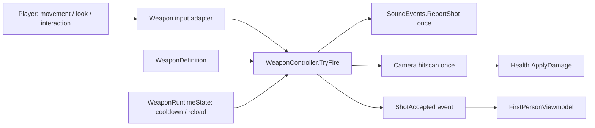

# Modular FPS weapon architecture — Task 3

Unity 6000.6.4f1. Implemented on `feature/fps-player-weapons-prep` in `/Users/dev/Desktop/game/Shift-Four-FPS-Prep`, continuing from the uncommitted verified Task 2 source on commit `2aece7603222c2fc3964779cf0da75e9a9456dd5`. The starting working tree and source hashes are captured in [task2-baseline.json](evidence/weapon-architecture/task2-baseline.json). Earlier task changes remain in place; no commit, push, merge, reset or stash was performed.

## Responsibilities

| Component | Owns |
| --- | --- |
| `PlayerController` | Movement, jumping, camera look/pose, interaction, cursor handling, player life/mission input state; exposes `ViewCamera`, `CanAct` and `Weapons` |
| `WeaponController` | Equipped definition, per-weapon runtime states, left-mouse input adapter, accepted-shot cooldown, the one player damage raycast, damage attribution, shot noise, equip/switch and reload lifecycle commands/events |
| `WeaponDefinition` | ScriptableObject authoring data: display name, damage, range and fire interval; positive finite validation |
| `WeaponRuntimeState` | One player's cooldown and reload state for one definition; retained when switching away/back; no mutable player state on shared definitions |
| `FirstPersonViewmodel` | Presentation event subscriptions/state and visual hierarchy collision isolation; never applies damage or performs a shooting raycast |



PlayerController's old `Shoot`, gun tuning fields and `nextShot` have been removed. Its Update delegates to `WeaponController.ProcessInput` after look, movement and interaction. WeaponController has no second fire-input Update loop. Its own Update only cancels reload state when the actor can no longer act. Interaction evaluation remains in PlayerController, extracted into `UpdateInteraction` for focused testing.

## MainLab wiring and fallback

No MainLab edit or saved prefab change is needed. In Play Mode, PlayerController.Awake reuses an existing WeaponController on the player root or adds exactly one, then initializes it. Duplicate Initialize calls do not reset cooldown or state. Editor OnValidate performs no weapon bootstrapping, asset creation or scene save.

With no definition assigned, the controller owns a transient `HideAndDontSave` fallback definition and destroys it on teardown:

| Setting | Preserved fallback |
| --- | --- |
| Damage | 25 |
| Camera raycast range | 30 m |
| Held-fire interval | 0.24 s |
| Damage attacker | Original PlayerController object |
| Damage reason | `Player hitscan shot` |
| Noise producer | `SoundEvents.ReportShot(player.transform.position)` |
| Typed/legacy gunshot notifications | Exactly one per accepted shot, including a miss |
| Noise Source | Null, matching the original producer |

MainLab's legacy numeric YAML entries remain byte-identical on disk and are no longer read as PlayerController fields. Their current values match the fallback above. New tuning belongs to WeaponDefinition. No authored `.asset` definitions, five-weapon loadout, imported weapon wrappers or hands assets are created in this task.

## Firing, input and lifecycle contracts

`ProcessInput()` reads the existing held left mouse button and passes it to `ProcessFireInput(held)`. The input adapter requires a locked cursor. PlayerController also retains its existing cursor guard: the click used to relock the cursor returns before weapon input processing, so it does not fire on that frame.

`TryFire()` is a programmatic gameplay command. It requires enabled weapon/player components, a configured player view, live Health and a mission that has not ended; it does not require a native OS cursor lock. This separates the input device state from the gameplay command while preserving the existing player controls. The batch editor cannot lock the hardware cursor, so tests exercise actual hitscan/damage via this command and separately verify that `ProcessFireInput(true)` rejects cursor-unlocked input.

For an accepted shot:

1. Snapshot the active definition's damage/range/interval and commit its cooldown before notifications.
2. Isolate registered viewmodel geometry from gameplay queries.
3. Build a ray from the current player camera's position and forward vector.
4. Call the original shot-noise producer once, before damage, preserving its ordering and position.
5. Perform one Physics.Raycast, ignoring triggers. The first solid hit blocks further targeting; self Health is not damaged.
6. Apply damage through the existing Health.ApplyDamage API, with the player as attacker.
7. Publish one `ShotAccepted(WeaponShot)` notification with the definition, player, camera ray, hit result, accepted time and configured damage.

Reentrant fire/equip requests during shot dispatch are rejected; the cooldown is already committed. Equip transitions also reject reentrant fire/switch requests. Presentation observer exceptions are logged without preventing accepted damage or later observers. A miss or cover hit still consumes cooldown and emits the accepted-shot/noise events, as the original input path did.

No Health, SoundEvents or drone damage implementation was changed. There is one player damage-query implementation, in WeaponController.

## Equip/switch, reload and presentation APIs

```csharp
weapons.Equip(definition);        // changes active weapon; same-definition request is a no-op
weapons.RequestReload();          // enters Reloading once; blocks fire
weapons.CompleteReload();         // returns to Idle once
weapons.CancelReload();           // returns to Idle once
```

`WeaponEquipped` fires once per actual equip. Each definition keeps its own runtime state in the owning controller, so switching back does not erase its cooldown. A shared definition used by two players does not share live state.

`ReloadStateChanged` publishes `Reloading` / `Idle` transitions. Repeated requests/completions are idempotent. Switching, disabling the weapon, player death, and inability to act cancel reload state. Completion/cancellation does not reset the firing cooldown. These are lifecycle hooks for later ammo/timing/animation work; no magazine simulation, automatic reload timer, wheel/number switching input or R reload binding is introduced. The existing single-weapon fallback retains its original unlimited held-fire behavior, and R restart remains unchanged.

FirstPersonViewmodel can live below the player camera and bind automatically to the player's weapon controller. It mirrors the equipped definition, reload state and last accepted shot and exposes presentation events. Binding is idempotent and disabling unsubscribes. Binding a presentation component to the player's root is rejected so it cannot disable the player capsule.

## Viewmodel query isolation

Registered viewmodel roots and all descendants are assigned Unity's built-in Ignore Raycast layer (2); their colliders are disabled. The hierarchy is refreshed immediately before weapon and interaction queries, including nested colliders added after initial binding. The actor root/capsule remains on its original layer with collision enabled.

Both queries use `Physics.DefaultRaycastLayers`, excluding the built-in Ignore Raycast layer; triggers continue to be ignored. This is the intentional mask change from the original all-layer query. MainLab's normal gameplay colliders remain queryable; cover blocking is tested. No TagManager, renderer, pipeline or custom-layer configuration is changed. Unity documents that mask in [Physics.DefaultRaycastLayers](https://docs.unity3d.com/6000.0/Documentation/ScriptReference/Physics.DefaultRaycastLayers.html).

## Files changed for Task 3

| Existing production source | Change |
| --- | --- |
| `Assets/Scripts/Gameplay/PlayerController.cs` | Runtime bootstrap/state access, weapon-input delegation, interaction extraction/mask; removal of old firing implementation and gun fields. Task 2 jumping/movement and camera pose logic remain. |

New production sources under `Assets/Scripts/Gameplay/Weapons/`:

- `WeaponController.cs`
- `WeaponDefinition.cs`
- `WeaponRuntimeState.cs`
- `FirstPersonViewmodel.cs`

New focused tests/helpers:

- `Assets/Tests/EditMode/Movement/WeaponArchitectureEditModeTests.cs`
- `Assets/Tests/PlayMode/WeaponArchitecturePlayModeTests.cs`
- `Assets/Tests/PlayMode/WeaponEventProbe.cs`
- `Assets/Tests/PlayMode/PlayerWeaponTestActions.cs`

Six existing Play Mode test files migrate their private Shoot/field reflection to the production weapon API while retaining behavioral assertions: `SoundEventsPlayModeTests`, `DroneDifficultyPlayModeTests`, `ProgressiveDifficultyValidationPlayModeTests`, `DroneMotorPlayModeTests`, `DroneDestructionPlayModeTests`, `MainLabProximityPlayModeTests`. The progressive-difficulty fixture now also respects cooldown between different target sequences, because the public command enforces cooldown itself. The shared test helper temporarily enables the fixture player and aims/restores the actual camera; it never applies damage or bypasses cooldown.

New scripts/folder have new meta/GUID files. All existing meta/GUID files, scenes, prefabs, imported assets, Health/SoundEvents, input settings, packages and rendering settings are preserved relative to the Task 2 starting snapshot. Documentation/evidence is added separately under this report and `docs/evidence/weapon-architecture`.

## Verification

| Run | Actual result |
| --- | --- |
| All existing + new Edit Mode tests | **323/323 passed**, final source, 1.889 s |
| Focused Play Mode | **32/32 passed**: 17 weapon architecture cases plus all 15 Task 2 jump cases |
| Relevant original Play Mode regressions | **50/50 passed**, 109.385 s; includes both previously intermittent Task 2 cases |

The focused cases check exact-once damage/noise/events, same-frame reentry, cooldown recovery, first-hit solid cover, trigger exclusion, miss/range behavior, camera direction/reconfiguration, attacker/reason attribution, death/end/disabled guards, cursor-unlocked input rejection, definition-specific tuning, switching cooldown retention, independent player states, reload transitions, viewmodel/query isolation, interaction/camera preservation and faulty observer isolation.

The original test selection covers sound events, combat/death/restart/cover, difficulty defaults and actual player shots, progressive difficulty cadence, MainLab proximity/height, rendered combat/destruction, player noise, four-room integration, raised visible drone-body hits, and the two previously unstable hearing/navigation cases recorded in Task 2. This is the relevant regression selection, not a claim that every Play Mode test was rerun.

Unity runs in the disposable copy retained from preparation. Imported Samples remain excluded **only in that copy** because the unchanged project still has the previously reported Input System/TMPro sample compile blockers. No package or sample fix is included here. Tests invoke production gameplay commands with real CharacterController/Physics/Health/scene components; native mouse/keyboard input is not synthesized.

Exact argument arrays, XML/logs, initial Task 2 preimages, final hashes and integrity checks are retained in [the evidence directory](evidence/weapon-architecture). Early fixture attempts are kept separately: the reflection constructor call selected UnityObject's implicit-bool overload, and the initial cursor-dependent fixtures assumed batch mode could lock the OS cursor. Final fixtures use the explicit command/input boundary described above.

Final source comparison found exactly the seven existing file modifications listed above and 17 new source/meta files. No existing file was deleted and no existing meta changed. The disposable copy matches the final worktree source outside the excluded Samples and Unity's platform-default serialization in its own `ProjectSettings/ProjectSettings.asset`; the exact difference is retained in `verification-only-projectsettings.patch`. The source worktree project settings remain unchanged. `git diff --check` passed. No shared asset edits or approvals were required.
