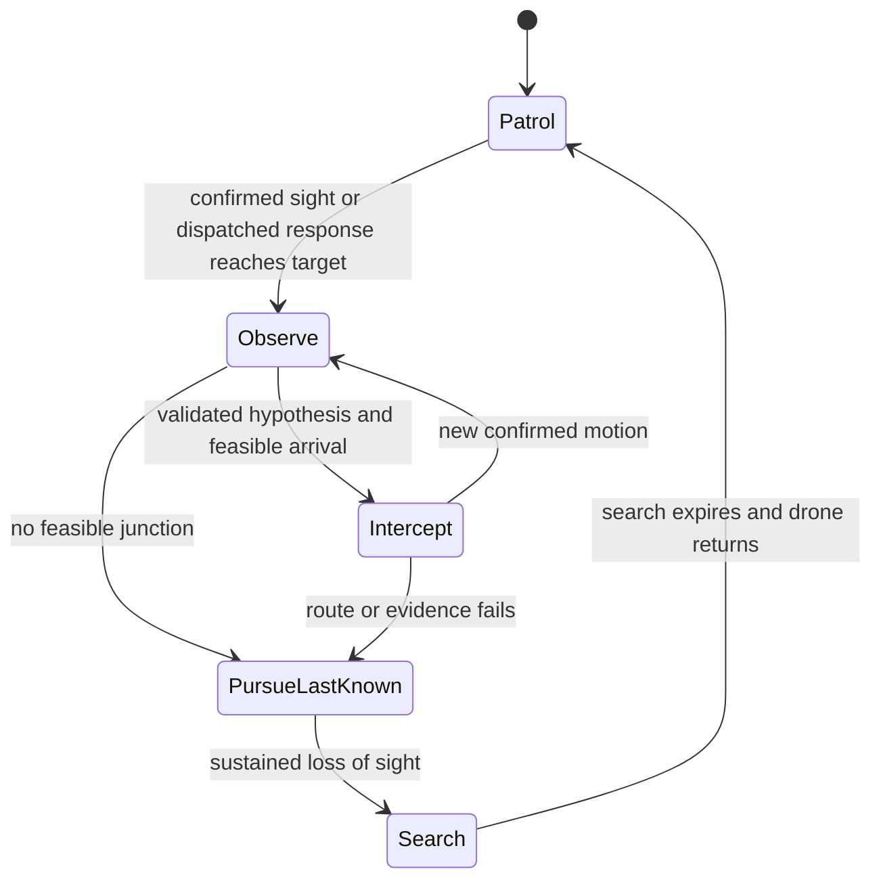

# Student 04 · Advanced Interceptor AI · F1

**GV Agent Controller · Control section · IS Interceptor**

F1 enables adaptive motion estimation and route-based multi-hypothesis prediction for the four Interceptors in `Assets/Scenes/OpenWorldPrototype.unity`. The local deployment work already provides four patrols at Checkpoint, Central Avenue, Control, and Storage, along with the shared two-responder limit. The outdoor response selects the F1 policy when an engagement begins.

## Baseline and integration

The previous outdoor policy smooths velocity from a short visual history with a fixed per-sample blend. It looks for achievable junctions along the estimated forward direction, evaluates validated player and drone routes, and uses arrival time, confidence, and commitment to pick one. Its cooldown, last-known pursuit, bounded search, and return logic also serve F1. The original one-argument policy constructor remains the baseline for comparison and serves the existing indoor behavior.

The outdoor brain still gates observations through its existing range and line-of-sight checks. F1 accepts finite, strictly newer visual positions. It records timestamp, source, reliability, measurement uncertainty, and a sequence identifier local to the track. Scout reports still start dispatch and guide the responder to an area. Their positions never enter the motion estimator. Observations inferred by the prediction model never enter the history. The tests feed identical authorized observations with different concealed positions and check that the decisions agree.

## Motion estimation

The filter works in the horizontal plane and takes height from the latest sighting. For an observation interval Δt, it calculates measured velocity from the position difference and measured acceleration from the change in measured velocity. The configured limits bound speed and acceleration.

- Position prediction uses **p̂ + v̂Δt + ½âΔt²**. The filter blends toward the measured position by **1 − exp(−9Δt)**.
- Velocity blends toward measured velocity by **1 − (1 − blend)^(Δt/0.3)**. Acceleration uses **1 − exp(−4Δt)**.
- A stop clears forward velocity. A sharp turn or reversal takes the new measured heading and clears acceleration from the old heading. An implausible displacement or a stale gap resets the filter.
- Horizontal residuals produce a bounded noise estimate σ. Between sightings the reported uncertainty grows as **√(σ² + [age × growth × (1 + 0.2 × speed)]²)**. The existing confidence decay also reduces the ability to commit to an interception.

The bounded, time-adjusted filter was chosen for F1 because it uses the existing settings and sighting cadence. A Kalman comparison was outside this experiment.

## Hypotheses and route validation

The model uses current movement evidence and the generated road junctions to propose **Continue, Left, Right, Stop, Reverse,** and **Alternate**. Alternate represents a reachable route that bends away from the continuing heading. Reverse needs braking evidence and a reachable route behind the observed heading. Roads and validated route delegates determine which moving hypotheses exist. Stop uses the observed position or brakes along a validated continuation. Turning and reversing hypotheses use lower initial travel speeds. Player distance integrates hypothesis acceleration until speed reaches zero or its configured cap. The model inverts that distance with 12 bisection iterations to estimate the arrival time. The default horizon is four seconds and F1 clamps it to one through five seconds.

The model ranks junctions using direction and distance, then requests at most **10** player-route probes per build. Each of five heading groups contributes up to two. It keeps a representative validated route for each hypothesis and normalizes the evidence weights by their sum. Weights reflect directional and acceleration evidence and route efficiency. They are relative plausibility scores.

A moving candidate also needs a complete, clearance-checked drone route through the existing waypoint graph and NavMesh validator. The existing motion-aware drone ETA uses accepted velocity, speed, braking, and acceleration. The candidate is eligible only within the arrival window. F1 uses normalized hypothesis support in place of the old forward-only score term and keeps existing timing, positioning, confidence, and stability terms. It adds no separate action selector. Losing sight permits only continuation of an existing interception whose route still validates. A changed graph or expired horizon clears speculative routes.

The build scans **J** junctions in **O(J)** with a fixed-size shortlist. It evaluates at most 10 shortlisted player routes and at most 10 corresponding drone routes. Pathfinding cost depends on the existing graph and NavMesh. The current outdoor response already spaces prediction work across decision ticks. **ShiftFour.Interceptor.Prediction** marks the hypothesis build for profiling.

## Measured comparison

Unity 6000.6.4f1 replayed the same eight tracks for both versions. Each track has 25 decisions at 0.3-second intervals. The tracks cover straight travel, acceleration, both turn directions, a stop, a reversal, concealed movement, and a blocked candidate. Both versions use the same fixed drone origin, junctions, and controlled route delegates. Each forecast starts from the last authorized sighting. The baseline follows its selected route at estimated speed or holds the last sighting when it has no candidate. F1 follows its most supported validated hypothesis. The evaluator, separate from the policies, compares each forecast with the future trace. [Per-track mean and median errors and counts](evidence/advanced-interceptor-f1/comparison.csv)

| Horizon | Baseline mean error | F1 mean error |
|---|---:|---:|
| 1 s | 2.00 m | 0.38 m |
| 2 s | 4.12 m | 1.20 m |
| 3 s | 6.28 m | 2.22 m |

F1 has higher 3-second error on the sudden-stop track, **2.36 m versus 0.77 m**. The pre-stop samples often favor continuing, and the previous policy falls back to the last sighting earlier.

A controlled interception counts as successful when the route ETA is at or below the candidate's player ETA and the future trace comes within **1.1 m** of the selected junction at that ETA. A point kept across consecutive ticks counts once. The baseline produced **7/25** successful attempts and F1 produced **6/22**. Both selected zero blocked goals. The policies issued **1,009** and **1,152** route delegate calls and recorded **8** and **6** candidate switches, respectively. The warmed 200-decision fixture took **2.97 ms** for baseline and **2.90 ms** for F1 including the reflection driver. These timings use small in-memory route fixtures. Live NavMesh CPU cost, garbage collection and frame-time impact remain unmeasured for F1.

## Unity verification and demonstration

The selected run passed **107 Edit Mode tests** and **38 Play Mode tests**. Tests cover adaptive acceleration, stop and reversal resets, normalized hypotheses, the route-probe budget, invalid and duplicate measurements, hidden-position independence, expiration, incomplete route rejection, and the existing A* and flight regression cases. The outdoor fixture also confirms that Central Avenue selects a forward junction with active normalized hypotheses through real player movement and sight. The three deployment and extraction seeds are **1234, 5678, and 9012**.

1. In Unity 6000.6.4f1 open `Assets/Scenes/OpenWorldPrototype.unity`, press Play, and start the mission. Use **F6** to open Interceptor diagnostics and **Shift+F6** to cycle units. Select **Outdoor Interceptor 02** for the central avenue demonstration.
2. Approach along the central avenue in clear sight. Walk along the road at a steady pace. Watch velocity, acceleration, hypothesis percentages, candidate type, and arrival margin. A candidate appears when the route and timing are feasible.
3. Stop or reverse while visible, then move behind solid cover. The panel shows changing motion estimates, increasing uncertainty, and the existing pursuit and search fallbacks.
4. In **Window → General → Test Runner**, run **InterceptorAdaptivePredictionEditModeTests**. The comparison writes `Logs/InterceptorEvidence/phase-f1-comparison.csv`. Run **OutdoorInterceptorPlayModeTests** to repeat the generated patrol, prediction, dispatch, and regeneration checks.

## Scope and files

F1 covers the visual motion tracker and multi-hypothesis route prediction only. Belief-state search and utility-action selection belong to F2. Later phases cover shared observations, coordinated reservations, outcome adaptation, and a live-world performance profile.

- `Assets/Scripts/AI/Agents/InterceptorBrain.cs`
- `Assets/Scripts/AI/Agents/InterceptorPolicy.cs`
- `Assets/Scripts/AI/Agents/InterceptorPredictionModel.cs` and its `.meta`
- `Assets/Scripts/WorldGeneration/OutdoorInterceptorDiagnostics.cs`
- `Assets/Tests/EditMode/Movement/InterceptorAdaptivePredictionEditModeTests.cs` and its `.meta`
- `Assets/Tests/PlayMode/OutdoorInterceptorPlayModeTests.cs`
- `docs/STUDENT04_ADVANCED_INTERCEPTOR_AI.md`
- `docs/evidence/advanced-interceptor-f1/comparison.csv`

## F2 · Utility selection and belief-state search

F2 adds an outdoor decision layer to the four Interceptors. The response lifecycle owns patrol, alert, combat, search, return, and destruction. The utility selector compares proposals for one decision and tracks the current commitment. The original indoor Interceptor uses its existing policy.

### Evidence and motion

- **Direct visual** evidence grounds the highest-probability region in a confirmed sighting. The F1 motion estimator and route hypotheses use that same observation. The outdoor response uses its existing range and line-of-sight checks.
- **Approximate sound** uses the player subset of the existing hearing ring. It carries the original emission time and expiry, an estimated position, and uncertainty. Audio can support investigation. Weapon authorization and the F1 motion tracker require visual evidence.
- **Scout reports** carry the sender identity and scaled-clock timestamp from the sighting event. Expiry and duplicate checks use that timestamp. Recent direct vision takes priority over conflicting approximate evidence.

### Belief and search

The belief is a list of regions with IDs, positions, evidence, probability, radius, and inspection status. The Inspector defaults to **16 regions**, configurable from **8–24**. New vision anchors most of the mass near the sighting and splits the rest across eligible F1 trajectories. During loss of contact each trajectory transfers its own mass along reachable, physically plausible steps. A stationary sighting can spread mass to four reachable neighbors. The source timestamps stay fixed during propagation. Expired regions are removed and the remaining weights are normalized.

For approximate evidence, the filter introduces a small set of reachable proposals. It multiplies each prior weight by **(1 − r) + r exp(−d² / 2σ²)**. Here **r** is age-discounted source reliability and **σ²** combines the reported uncertainty with the region radius. It then renormalizes. The weights are heuristic relative beliefs.

Search ranks regions by probability, evidence strength, and **−p log(p)** weighted by a radius-based coverage proxy. It checks up to six routes per evaluation and discounts travel cost. When a drone reaches a selected region, the sensor checks the approximate eye-height center and four surrounding points against its range, arc, and collision scene. A covered visit multiplies the region weight by **0.18** and normalizes again. An occluded visit records occlusion and preserves its probability. Search ends on its configured deadline, evidence expiry, or the existing response deadline.

### Utility

The score clamps **base − travelPenalty × travel − uncertaintyPenalty × uncertainty + stabilityBonus** to **[0,1]**. Travel normalizes estimated seconds over eight seconds. Uncertainty normalizes radius over ten metres. Defaults use a **0.4-second** planning interval, **0.8-second** commitment, **0.10** switching margin and **4.5-second** search budget.

| Action | Eligibility and base value |
|---|---|
| Patrol | Available post, 0.55. A fresh sound needs a reachable route and must beat an entry value of 0.47 after costs to use a response slot. |
| Observe target | Confirmed sight, 0.47 plus 0.12 scaled by the remaining room to improve confidence. |
| Intercept | Valid F1 route and feasible ETA, 0.74 plus 0.12 times confidence plus 0.10 times normalized arrival margin. |
| Pursue last known | Valid recent visual or Scout route, 0.75 for a visual approach or 0.81 toward a Scout report. Hidden visual pursuit starts at 0.72 and drops by 0.06 per second up to four seconds. |
| Investigate sound and search region | Reachable evidence. Base 0.34 plus 0.28 times belief probability, 0.27 times source strength, and a coverage-based information term. |
| Reposition | Physically reachable alternate position during burst recovery, 0.97. |
| Return to patrol | 0.23 against search options. Expiry forces a return or a safe hold if the return route is blocked. |
| Attack | 1.00 when confirmed sight, range, readiness, and burst timing permit it. The shared firing path checks pivot and muzzle clearance before authorizing the shot. |

A route failure invalidates the previous proposal immediately at evaluation. The switching margin applies only when the incumbent still qualifies. Reacquired vision can interrupt a search. Sight, sound, and Scout reports use the existing two-unit response budget. New destinations use existing A*, NavMesh and physical clearance queries. The motor applies the existing movement profiles.

### Verification and profiling

Unity 6000.6.4f1 passed **113 Edit Mode** and **39 Play Mode** tests. The run covered sensor conflicts, stale and duplicate evidence, blocked propagation, normalization, negative evidence, commitment and hard rejection. The generated sound fixture investigated an approximate player emission with no accepted visual observation or firing, then ended at expiry. Existing outdoor tests covered the four stations, direct prediction, Scout dispatch, regeneration, collision and extraction on seeds **1234**, **5678**, and **9012**.

The warmed 1,000-decision Edit Mode fixture took **27.876 ms**. The generated sound response recorded **7** samples at **1.92 ms mean** and **6.04 ms peak**, with **10** peak route queries in one decision.

The profiler time comes from the generated scene during a sound investigation and includes that response's route validation. The warmed Edit Mode timing includes in-memory routes and the reflection driver. Whole-frame CPU and GPU impact, managed-allocation profiling, and a live profile with two simultaneous searches remain open.

### Demonstration

1. Start **OpenWorldPrototype** in Unity 6000.6.4f1. Press **F6** and select **Outdoor Interceptor 02** with **Shift+F6**.
2. Walk along Central Avenue in clear sight to compare observation, pursuit, and interception. Break sight behind solid cover to see region weights, inspection status, the selected search destination, and the actual path.
3. Fire the pistol near a reachable outdoor Interceptor while behind cover to see sound investigation. Leave the area and watch for evidence expiry and return to patrol.
4. Run **InterceptorBeliefUtilityEditModeTests** and **OutdoorInterceptorPlayModeTests** in **Window → General → Test Runner**.

### F2 files

- Assets/Scripts/AI/Agents/InterceptorBeliefState.cs and its .meta
- Assets/Scripts/AI/Agents/InterceptorUtilityDecision.cs and its .meta
- Assets/Scripts/AI/Agents/InterceptorBrain.cs and InterceptorPolicy.cs
- Assets/Scripts/AI/Core/DroneBrain.cs and Assets/Scripts/AI/Perception/DroneHearingSensor.cs
- Assets/Scripts/WorldGeneration/OutdoorInterceptorResponse.cs, OutdoorInterceptorDispatch.cs, OutdoorInterceptorDiagnostics.cs, and OutdoorScoutEncounter.cs
- Assets/Tests/EditMode/Movement/InterceptorBeliefUtilityEditModeTests.cs and its .meta
- Assets/Tests/PlayMode/OutdoorInterceptorPlayModeTests.cs
- docs/STUDENT04_ADVANCED_INTERCEPTOR_AI.md
