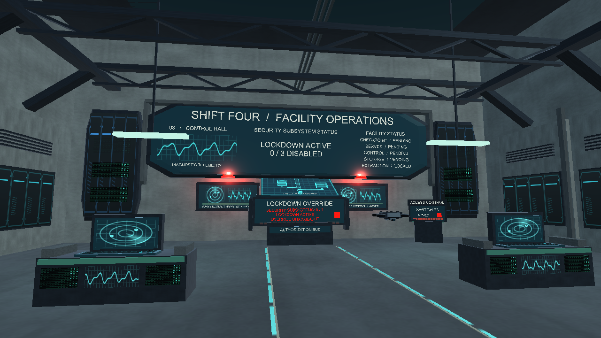
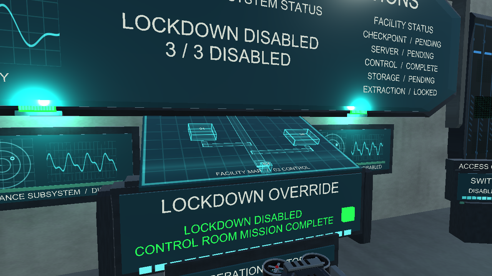
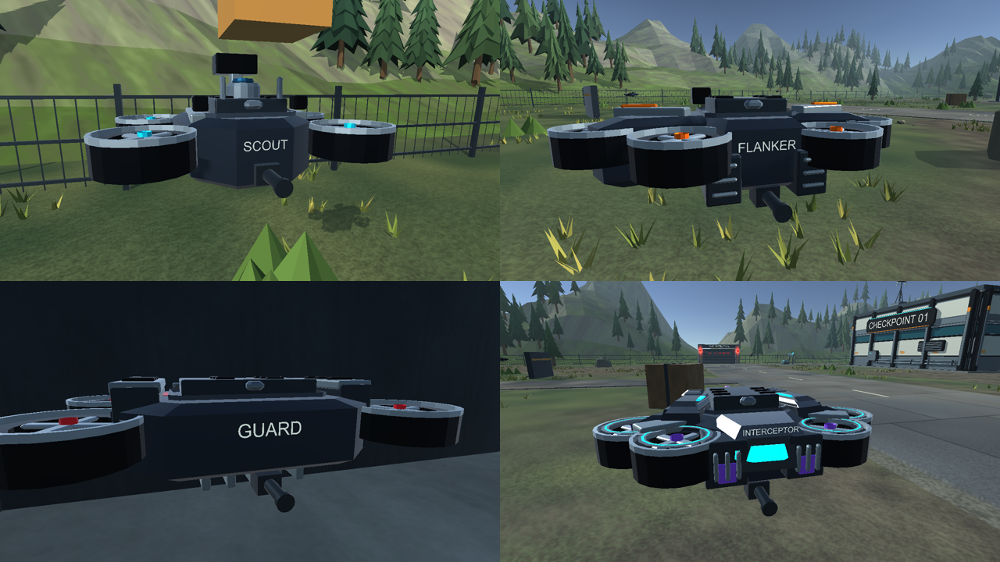

# Student 04 · Control Hall and drone identification

**Asmadala · GV Agent Controller · Control section · IS Interceptor**

Phase D runs in `Assets/Scenes/OpenWorldPrototype.unity`. The player's first view inside Control now looks down two guidance lines between the operator desks toward a single operations wall. From there the player can see which security subsystems are armed and which facility objectives have actually been completed.

## From the earlier hall to the command deck

The original hall had two desks, three monitors, three switches, a central override and two warning beacons. Its radar displays were animated, but the four shapes above the override always occupied the same positions. The Control branch of `HallInstrumentation.Build` now dresses those fixtures with keyboard matrices, operator scopes, avionics cabinets, perimeter access panels, ventilation grilles, an overhead cable tray and exposed trusses. The two existing warning lights supply the red and restored teal illumination. The pendant lights provide a cool neutral base.

The command wall labels its moving waveforms as diagnostic telemetry. The radar sweep is illustrative. The security count, individual subsystem states, facility completion list and extraction readiness read the existing mission objects. The three lower monitors correspond to surveillance, the security network and access control.

## Projecting the generated facility

When `WorldGenerator.BindMissions` binds the player's facility map, it passes that same snapshot and the generated mission manager to the Control instruments. The projector uses `FacilityMap.ProjectBounds` for the four foundations and road slabs, and `Project` for the actual extraction gate. Projected north follows world +Z. A raised amber outline identifies Control before completion. Completed sites turn teal. The gate reports the existing extraction manager's readiness. A shader draws the survey grid and scan line. The projection contains no actor positions or additional cameras.

## Mission, lighting and sound

| Player action | Control Hall response |
|---|---|
| Enter under lockdown | Red beacons pulse slowly. The monitoring bed plays near the hall and the advisory repeats at twelve-second intervals while the listener remains inside. |
| Use an armed switch | Its real switch changes state once. The corresponding monitor changes to disabled, the station meter briefly brightens and the HUD reports the new count. A spatial relay rises in pitch with progress. |
| Use the third switch | The panel authorizes override in cyan. The HUD directs the player to the terminal and the hall uses its authentication cue. Emergency lighting continues. |
| Use the authorized override | The existing completion event grants the Storage key immediately. The panel confirms lockdown disabled. A 1.2-second verification sweep, relay and final authentication accompany the change to steady teal lighting. |

The existing HallAudio subscriptions own these cues. Advisory and confirmation share the hall's spatial signal source and its proximity and effects gain. Completion interrupts the advisory. Scaled time and listener pause suspend the confirmation during menus. Rebinding or disabling the hall cancels any pending cue. The audio emits no gameplay noise events.

## Identifying drones

The prototype maps each registered brain component to its flight role. Outdoor Scouts retain their ScoutBrain identity even when the outdoor adapter controls their movement. The combat HUD uses the existing Health, gameplay mask, camera bounds and live-body checks. A clear crosshair hit reveals the label and extends it by 0.65 seconds. Accepted player damage extends the window to three seconds. A recent hit still requires a clear view. Aimed targets reuse the crosshair hit for visibility. The name and current / maximum HP have separate text columns. Bar and damage-trail colors retain their combat meaning.

The runtime Combat Hud component on the player offers **Aim Or Combat**, **Visible Nearby** and **Off** under **Drone Identification**. The default range is 30 m. Nearby mode additionally reveals unobstructed drones within 12 m. Off hides role text and preserves damage bars. The name colors are cyan for Scout, amber for Flanker, green for Guard and red for Interceptor.

Each prototype flight rig also receives a single depth-tested TextMesh on its animated model. The three standard markings sit on the flat fuselage end plates. The Interceptor uses its fixed optical brow. All stencils share the facility lettering material and font atlas. They have no colliders. The three-dimensional stencils remain physical paint when HUD identification is off.

## Unity and academic demonstration

1. Open the project in Unity 6000.6.4f1. Open `Assets/Scenes/OpenWorldPrototype.unity`, press Play, and start the mission from the title screen. The generator builds the new fixtures and markings at startup.
2. Collect supplies, unlock Checkpoint and authenticate its card. Open Server and activate terminals **2 → 1 → 3**. Use the awarded Control key at the Control entrance. Use **M** to compare the outdoor road and building layout to the model above the main override.
3. Try the override early. Activate the three existing stations in any order using **E**. Look back at the operations monitors and verify the corresponding labels and progress. Reuse one station to check that the count and audio advance only once.
4. Press **E** at the authorized override. Observe the verification strip, room lights and HUD notification. Listen for the relay and final authentication, then wait at least twelve seconds to check that the emergency advisory has stopped. Open Storage with the awarded key. **Tab** opens the mission overview.
5. Aim at an outdoor Scout, an ambushing Flanker, an indoor Guard and a responding Interceptor. Damage a visible drone, take cover, then return. Compare the HUD name, HP and physical lettering at close range. Defeat it and verify the HUD clears. Use **F6** and **Shift+F6** in the Editor to demonstrate the earlier controller and Interceptor diagnostics.
6. Pause, resume and test different display sizes and SFX levels. For each demo seed, turn off **Random Seed On Start** on World's World Generator, set **Seed** to **1234**, **5678** or **9012**, and press Play. During Play the component's **Generate World** context command starts a fresh layout. The three stations should return to armed.
7. Under **Window → General → Test Runner → PlayMode**, run `ControlProjectionUsesGeneratedFootprintsAndImmediateMissionRewards` and `OutdoorIdentificationResolvesEachRoleAndRespectsCover` for a repeatable assessment. Set the environment variable `SHIFTFOUR_CONTROL_CAPTURE` to a writable folder before launching Unity to reproduce the rendered evidence. The tests move the assessment camera and directly invoke the same interactables that handle E.

## Exact Phase D files

| Directory | Files |
|---|---|
| Assets/Scripts/WorldGeneration | ControlLockdownMission.cs, LockdownSecuritySwitch.cs, HallInstrumentation.cs, HallInstrumentation.Control.cs and HallInstrumentation.Control.cs.meta, HallAudio.cs, ResearchInteriorBuilder.cs, WorldGenerator.cs, PrototypePlayerFeedback.Notifications.cs |
| Assets/Scripts/Gameplay | DroneRotorVisuals.cs, UI/CombatHud.cs, UI/CombatHudRenderer.cs |
| Assets/Shaders | HallInstrumentation.shader |
| Assets/Tests/PlayMode | HallAudioPlayModeTests.cs, OpenWorldCollisionPlayModeTests.cs, OutdoorMissionMenuPlayModeTests.cs |
| docs | STUDENT04_CONTROL_HALL_PHASE_D.md |
| docs/evidence/control-phase-d | lockdown.png, restored.png, drone-markings.png, results.csv |

## Recorded assessment evidence

These are rendered frames from an isolated Unity 6000.6.4f1 Editor running Play Mode with Metal. The hall views use seed 1234. The restored view comes from a test which activates only Control. The other buildings therefore correctly read pending. The four drone portraits are camera close-ups of generated instances. The pictures show the physical lettering. The automated HUD checks separately exercised the crosshair and damage reveal logic.

| Seed | Generated Control and projection | Gameplay regression |
|---|---|---|
| 1234 | Four projected foundations and the gate matched world coordinates. Road count matched the map. Three switches authorized one override. | Immediate Storage key, door traversal, live drone bindings and extraction passed. |
| 5678 | The projection followed the new layout. Switch state and lighting reset on regeneration. | Immediate Storage key, door traversal, live drone bindings and extraction passed. |
| 9012 | The projection followed the new layout. Switch state and lighting reset on regeneration. | Immediate Storage key, door traversal, live drone bindings and extraction passed. |

The selected **89 Edit Mode tests** cover waypoint graph logic, Interceptor policy and animation. The **30 Play Mode cases** cover generated Control fixtures, real health and role identities, cover and defeat, HallAudio, HUD notifications, menu and map behavior, death/restart, the cinematic ending, Interceptor dispatch and the 400-query A* comparison with independent Dijkstra results. The results table identifies the fixture and case for each outcome. [Per-case Unity results](evidence/control-phase-d/results.csv)

The static metalwork uses four material batches. Existing lights and the hall's two spatial AudioSources handle the room. The graphics share one instrument material and use property blocks. The command board samples at most once every 0.15 seconds and writes changed values. On this machine, 4,000 warmed calls to the steady-state command-board refresh took **0.612 ms** with **zero recorded managed allocation events**. A deliberate allocation produced one calibration event. This measures that method on the Editor main thread. GPU frame time and the full cost of a populated scene require a separate profile.

Remaining manual checks include reading HUD text on the smallest supported screen, judging spatial sound levels on speakers or headphones, and playing an uninterrupted human-controlled run from the title screen to extraction. The optional Nearby and Off Inspector settings also merit a visual check. Automated mission tests invoked real interaction handlers and exercised generated door and player collision separately.
