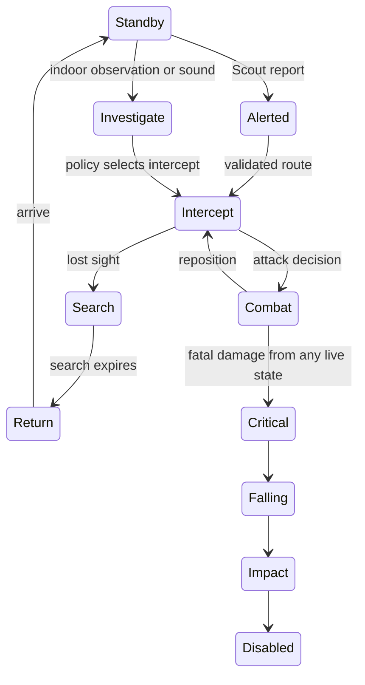

# Student 04 · Interceptor flight presentation

**GV role** Agent Controller · **Section** Control · **IS agent** Interceptor

## Contribution

The original FBX, alternating rotors, gimballed weapon, accepted-shot effects, flight integrator and physical wreck are team systems. The prediction policy and accepted motion come from Phases A and B. Phase C adds graphite shoulder armor, bevelled steel louvres, four identification stripes per shoulder, illuminated fan shrouds and a separately articulated optical head. Five collider-free mesh batches use a shared URP Lit material. Their cached renderers use property blocks for the lens, armor impact flash and propulsion illumination.

The normal Interceptor prefab constructs this kit in DroneRotorVisuals.Awake. OutdoorInterceptorDispatch spawns the actual response units and WorldGenerator.ConfigureDroneCombat applies their existing outdoor flight role. Expand a response station and find **Interceptor IV airframe** under the unit’s model. The original visual owner animates the kit after physical movement. Its wreck builder excludes the new decorative meshes when building collision shapes.

## Motion and decisions

Accepted horizontal velocity comes from DroneMotor. The model owner measures signed yaw rate and differences successive velocity samples in model space. The existing pose blends pitch and bank toward their targets with weight `1 − exp(−9 Δt)`. Forward acceleration pitches the nose down, braking lifts it, and signed turn rate and lateral acceleration drive banking. The final combined outdoor pose is limited to 14°. Phase C scales the existing hover by `1 − 0.85 × clamp01(speed/referenceSpeed)`, reducing the full-speed excursion from 20 mm to 3 mm. The emissive engine rings follow the smoothed rotor-speed signal. Distance throttling and pause apply to the new animation.

Standby and return use cyan. A dispatch or combat turns the sensor red. Investigation, interception, repositioning and search use amber. The optical head sweeps ±12° in standby. Search adds a ±18° sweep around the last recorded area. Interception follows an accepted waypoint and combat can focus on the brain’s authorized visible aim point. The indoor mapping reads observation, prediction, sound investigation and return from the existing policy. Sensor yaw and color approach new targets exponentially.

The accepted ShotFired event continues to trigger the original flash, tracer and receiver recoil. The existing combat HUD places sparks at the real hitscan contact. Accepted nonfatal damage briefly warms the new armor and lens as the pose stabilizes. Fatal damage cancels firing, reuses the spark renderer for failure and starts the existing fall and rotor spin-down. First contact produces sparks and a low relay sound. Final settling turns the new lights fully dark. The existing flight loop shifts between 0.91× and 1.13× pitch with speed. Dispatch, failure and contact share GameplayAudio’s spatial voice pool and settings. The alert and contact sounds reuse hall advisory and relay recordings. Dedicated Interceptor motor and crash recordings are absent.

## Unity and assessment demonstration

1. Open Assets/Scenes/OpenWorldPrototype.unity in Unity 6000.6.4f1, enter Play and start the mission. In the Editor or a Development Build, press **F6** and **Shift+F6** to inspect and cycle the actual responders. Frame the unit with **F** in Scene view to see its cyan lens scanning independently.
2. Let a Scout detect the player outdoors. Follow the dispatched unit with F6 in automatic mode. Move laterally, then take cover. Correlate lens direction and color with the decision, speed, signed yaw rate, forward acceleration, pitch, bank and rotor RPM. Wait for search and return.
3. Enter clear firing range, observe the aligned tracer and shoot once for the amber hit reaction. Deliver lethal damage and follow the same wreck to contact and shutdown. Pause and resume. Compare graphics presets and audio balance in the human-played Game view.
4. For a **controlled** demonstration, run DroneAnimationEditModeTests under Window → General → Test Runner for deterministic acceleration, turns, braking and shutdown. Run OutdoorInterceptorPlayModeTests for generated response stations, genuine dispatch, pause and controlled damage. Set SHIFTFOUR_INTERCEPTOR_CAPTURE to a writable folder before starting the Editor to reproduce the close-ups. The temporary capture camera exists only in the test. [Standby](evidence/interceptor-phase-c/standby.png) · [Dispatch](evidence/interceptor-phase-c/intercept.png) · [Damage](evidence/interceptor-phase-c/hit.png) · [Shutdown](evidence/interceptor-phase-c/shutdown.png)

## Verification and limitations

Across the selected suites, **15/15 distinct Edit Mode cases and 69/79 distinct Play Mode cases passed**, counting the latest result for each case. Both new or extended outdoor tests and the warmed allocation benchmark passed together on the final code. Tests verified generated geometry on three units per world, clearance at the 14° outdoor limit, regeneration on seeds 1234 and 5678, response to real Scout reports, accepted damage, pause, single death and zero final lens emission. Extraction passed on seeds 1234, 5678 and 9012. [Per-test results and comparison](evidence/interceptor-phase-c/results.csv)

The warmed Editor benchmark measured **18.695 ms for 4,000 mixed-role animation ticks**, with zero detected managed allocation events and one calibration event. This is a CPU fixture measurement. Standalone GPU performance, human audio balance and artistic review across Low, Balanced and High remain unverified.

Four speed tests and five sensing tests had the same failures before Phase C, including earlier speed expectations and a hidden-target observation count. The legacy MainLab rendered montage stopped at its Flanker player-shot assertion on both the candidate and a pre-Phase-C comparison run. The independent outdoor capture fixture produced all four images.

## Exact Phase C files

| Directory | Files |
|---|---|
| Assets/Scripts/Gameplay | InterceptorAirframe.cs, InterceptorAirframe.cs.meta, DroneAnimationPose.cs, DroneRotorVisuals.cs, DroneWreckMotion.cs, GameplayAudio.cs |
| Assets/Scripts/AI/Agents | InterceptorBrain.cs |
| Assets/Scripts/WorldGeneration | OutdoorInterceptorResponse.cs, OutdoorInterceptorDiagnostics.cs |
| Assets/Tests/PlayMode | OutdoorInterceptorPlayModeTests.cs |
| docs | STUDENT04_INTERCEPTOR_ANIMATION_PHASE_C.md |
| docs/evidence/interceptor-phase-c | standby.png, intercept.png, hit.png, shutdown.png, results.csv |
