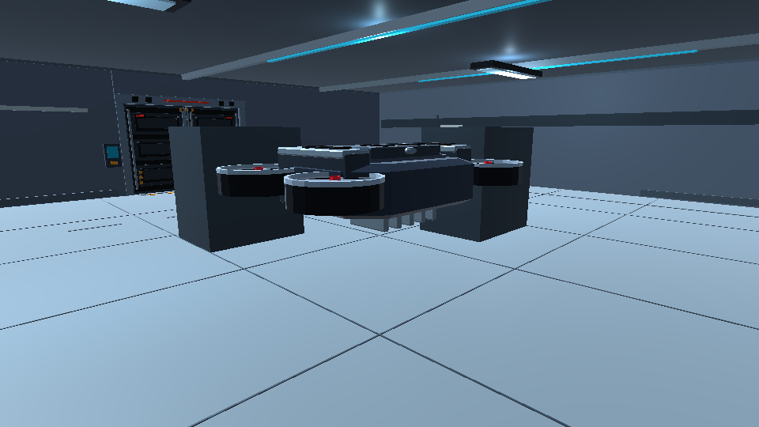
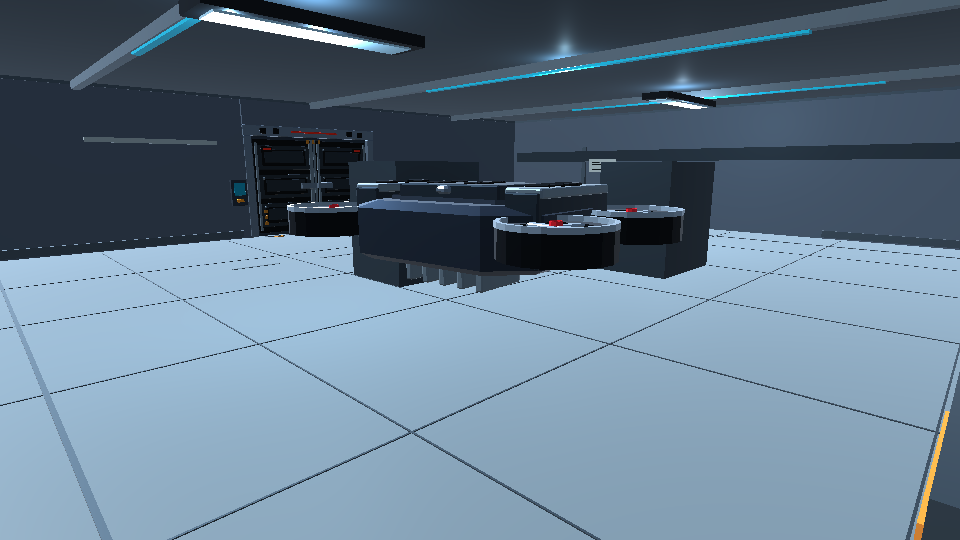
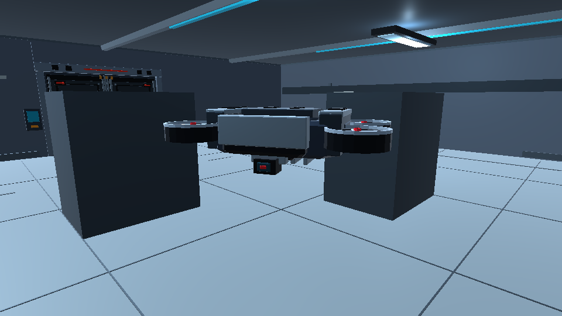

# MainLab — Guard defends Server and checks a local disturbance

These frames are actual renders from the disposable Unity 6000.6.4f1 candidate project. No models, rooms, lighting, MainLab data or baked navigation were regenerated. A temporary in-room evidence camera follows the existing Guard. Runtime fixtures freeze unrelated brains and player input, and controlled simulation timing makes the sequence reproducible.

Run from the repository root:

```sh
python3 docs/evidence/advanced-guard/rehearse.py --demo-only
```

The script prints a review project and `ReviewResults` directory. To inspect it in Unity, use `--prepare-only`, open the printed project, and run `AdvancedGuardPlayModeTests.MainLab_Demonstration_GunshotInvestigationStaysInServerAndReturnsToPost` in the PlayMode Test Runner. Do not run scene installers or bake navigation.

| Phase | Expected behavior |
| --- | --- |
| Suspicious | A nearby typed gunshot is heard with no player visibility. Guard initially keeps its defensive post. |
| Investigate | After awareness dwell, Guard follows a validated local goal at the 2.5 m/s investigation cap. |
| Search | Guard remains near the uncertain disturbance while evidence expires. |
| ReturnToPost | Guard heads back to a body-clear point adjacent to its blocked authored Home, using the 2.0 m/s post cap. |
| Patrol | The defensive post remains selected, suspicion is zero, and no hidden target is retained. |

The test asserts that actual Guard root motion and goals remain inside the Server area, that it genuinely moves, that it reaches the post, and that the sound alone produces neither visual memory nor player damage. `MainLab-demo.csv` records times, awareness state, selected decision, suspicion, root/goal coordinates, target/current movement speeds and visual confirmation. Each image has a matching `.txt` state/position sidecar. Captions and the trace identify phases; the screenshots themselves are gameplay renders, not an awareness HUD.

**Suspicious — post maintained**



**Investigate — local disturbance**


**Search — bounded evidence**



**Return — defensive post**


**Patrol — resumed defense**



The other nine Guard tests cover cases that this sound-only sequence does not visually establish: actual console activation, close visual combat, cover-blocked damage, observed player relocation, stable cover commitment, physical cover arrival, closed/open gate rejection and death. The separate actual-console test uses the existing Server console and one successful activation; its new offset is 1.25 m along local backward direction, placing the sensing anchor on walkable interaction space. A player can inspect the same interaction in the disposable project by entering Server through the normal Checkpoint progression and using `E` at the Server console. Normal left-click shots supply gunshot events. Human combat/balance review remains pending owner approval.
