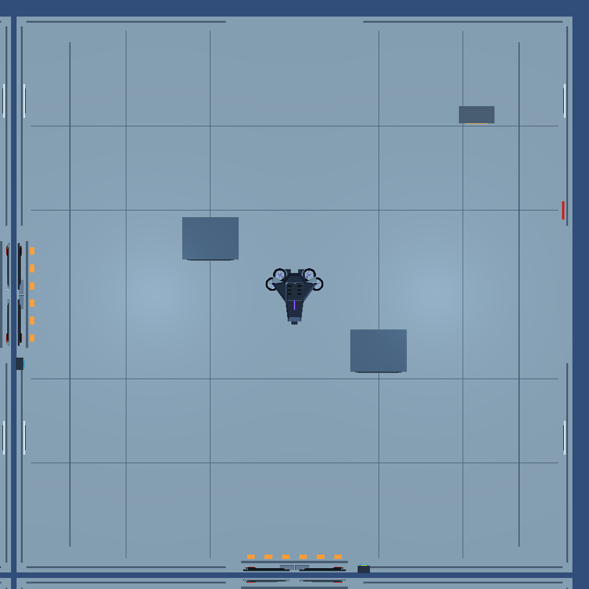
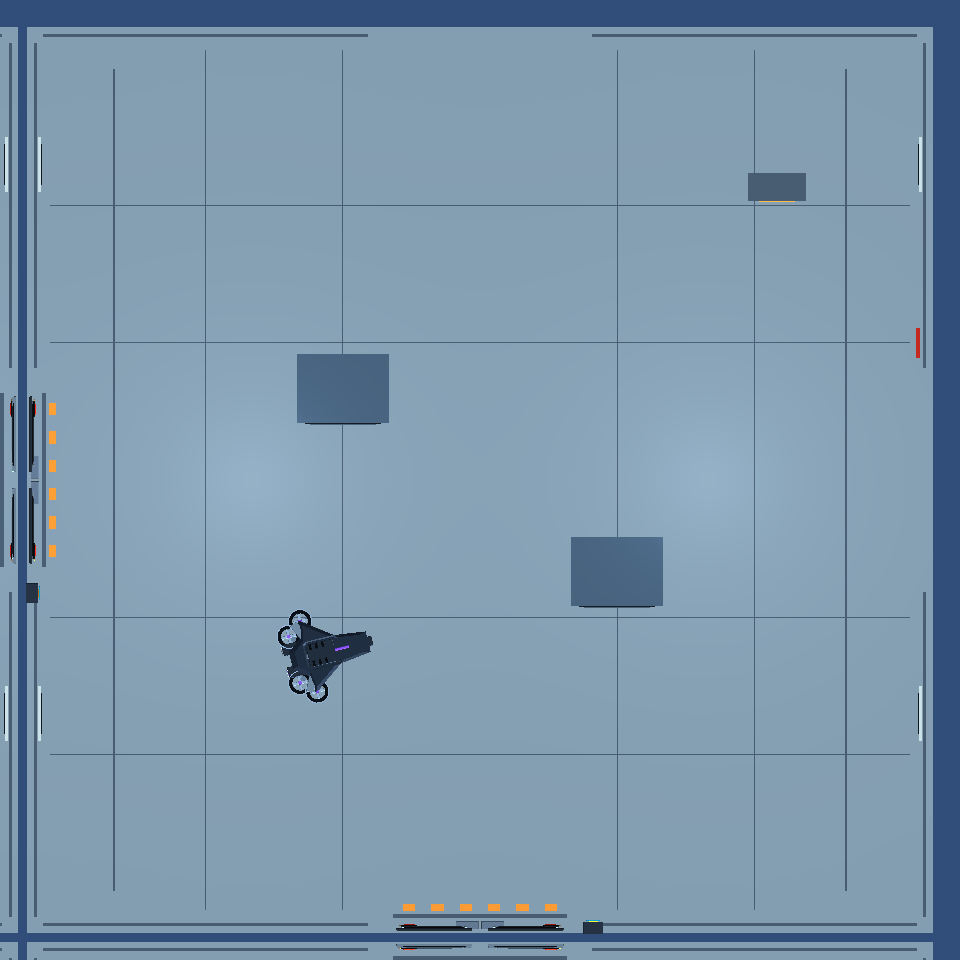
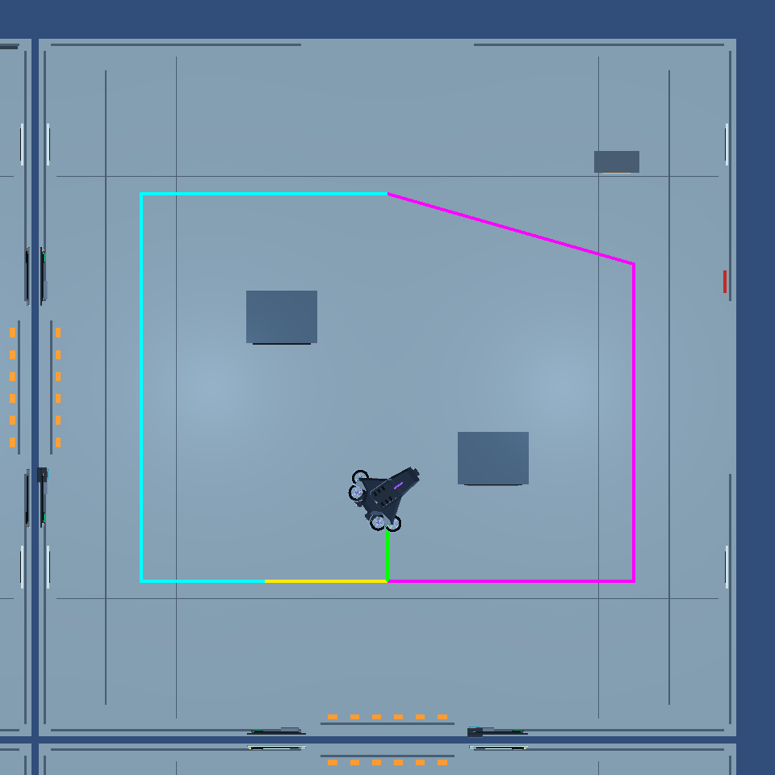
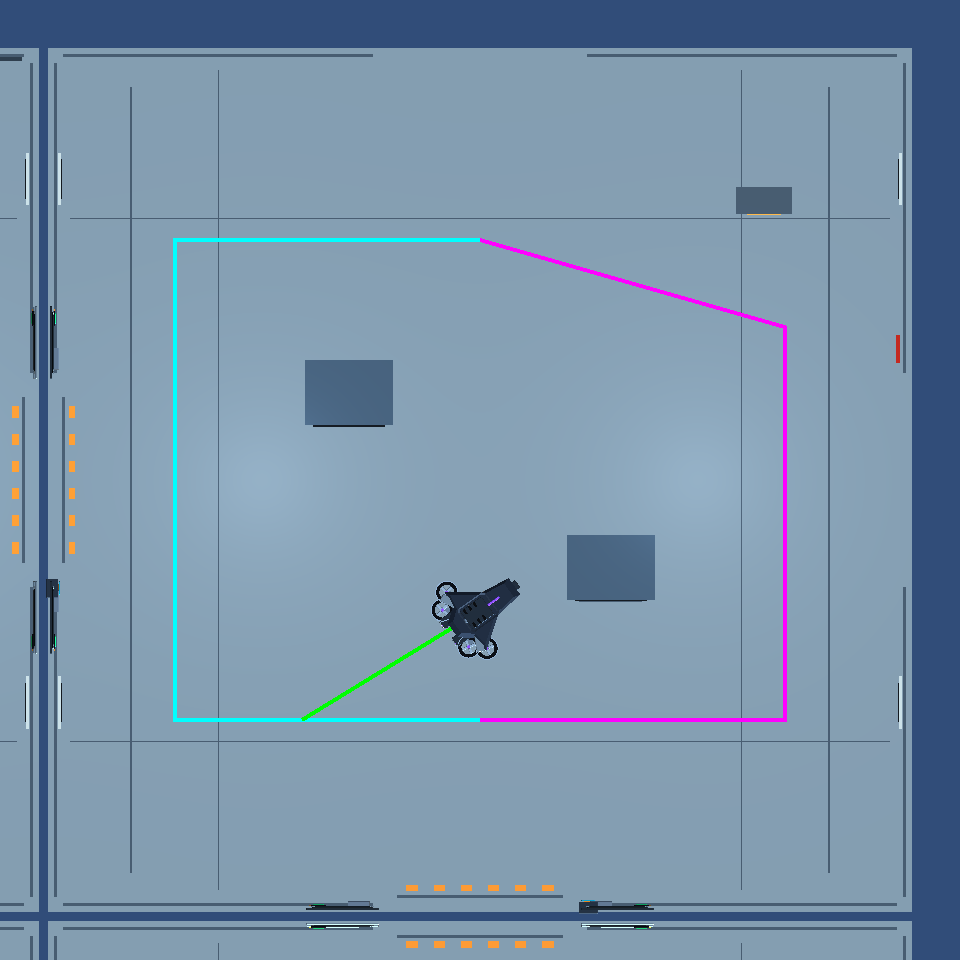
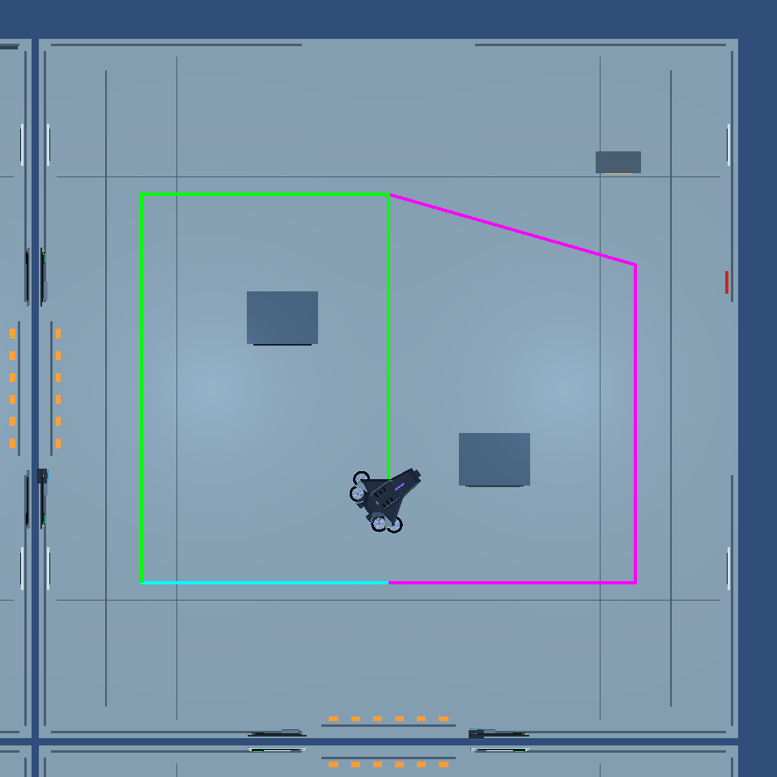

# Task 10 — Reproducible Control scenarios

These are actual Unity MainLab runs, using Unity 6000.6.4f1. Scene geometry, gates, NavMesh, prefabs, motor and other policies are unchanged. Temporary test cameras and route lines exist only during Play Mode. CSV records are the behavioral evidence; images show their corresponding physical setting.

## 1. Sound without a player sighting

Run from the repository root:

```sh
python3 docs/evidence/sensor-interceptor/reproduce.py --scenarios-only
```

This creates a disposable project, substitutes the two saved original Interceptor sources for the baseline run, restores the current sources, then repeats the same scripted MainLab scenario. No active file is substituted. Both runs use `MainLab_SoundResponse_BeforeAfterEvidence`. Other brains/motors and player input are frozen; the player is moved far outside vision. The Interceptor starts at the scene root near (10, 0.01, 6), with home (10, 0, 10). The fixture reports nearby gunshots in fixed cardinal order until production hearing supplies a reachable uncertain point. Sound uncertainty and the first accepted direction may vary between instance IDs, so actual roots/goals are recorded rather than claimed identical.

The test enables real movement and samples decisions every 0.3 seconds. It captures the first frame in each awareness phase. The orange overlay is the currently validated native route to the motor's next stop. A route line may be absent at a reached goal. Images are rendered from a temporary top-down camera below the existing roof.

| Saved original | Updated adapter |
| --- | --- |
|  |  |

The original adapter receives hearing/awareness but keeps the `WatchHome` decision and never acts on sound. The updated adapter investigates, reaches the approximate location, holds a bounded sound-area search, then physically returns home after expiry. In both runs, visual history stays empty and `LastObservedAt` stays negative infinity. Sound does not grant combat confirmation or manufacture velocity.

Measured results are in [scenario-measurements.json](scenario-measurements.json), [original trace](before-sound/sound-response.csv) and [final trace](after/sound-response.csv). The new fixture requires at least three active investigation/search decisions, entry into sound search, and actual arrival within 1.2 m of home. The separate `ReturnHome_FromEastSoundArea_UsesSafeControlStops` fixture starts at (12.635, 0.01, 5.527), where raised furniture defeats a direct native approach, and verifies actual safe return via Control connectors.

For interactive review, use `reproduce.py --prepare-only`, open the printed project in Unity, and run `InterceptorSensorIntegrationPlayModeTests.MainLab_SoundResponse_BeforeAfterEvidence` in the Play Mode Test Runner. Alternatively play MainLab, select the Interceptor, enable its existing `showControlTactics` diagnostic, and produce a gunshot while occluded. Orange goals/routes are hearing; cyan predicted trajectory and scored junctions come from visual history. Runtime cap targets are 2.5 patrol, 3.1 investigation and 3.7 chase m/s; health is 125.

## 2. Prediction, reversal and cover

The original and final full runs include the existing rendered Control prediction scenario. It supplies genuine visible forward movement, a genuinely observed reversal, then occlusion and hidden movement. The Interceptor must retain its last real observation, reject stale forward momentum, and use bounded search rather than chase the hidden transform.

| Phase | Original source | Final source |
| --- | --- | --- |
| Forward prediction |  |  |
| Observed reversal |  |  |
| Occluded search |  |  |

Compare [original phase record](before/rendered-prediction.csv) and [final phase record](after/rendered-prediction.csv). The advanced algorithm remains responsible for candidate scoring, confidence, direction-change replans, commitment/hysteresis, missed windows, candidate cooldown and fallback. Existing native/gate-aware tactical tests run alongside the integration tests; a locked Control gate rejects a sound approach and invalidates unavailable routes.

## 3. Identical-input ETA comparison

[Motion timing comparison](after/motion-before-after.csv) runs the same advanced policy twice, with identical sightings, timestamps, candidates, route delegates and settings. One instance uses its retained explicit cruise-timing API; the other uses the live motion-aware API. At 1.8 seconds, both choose candidate 0 at (10, 0, 0), confidence 1, player ETA 3.2268 seconds. The route from drone (9, 0, 2) is 2.236 m long, speed cap 3.7 m/s and acceleration 8 m/s² from rest:

| Timing model | Drone ETA |
| --- | ---: |
| Prior cruise contract | 0.6043 s |
| Acceleration + braking | 1.0668 s |

The difference accounts for acceleration/braking cost; it is not a claim of faster capture. Other new tests cover stationary observations, observed reversals, route corners, own velocity heading, cap/acceleration changes, invalid inputs, unchanged score weights, repeated hidden ticks and failed arrival cooldowns.

## Evidence limits

These scenarios demonstrate reproducible decisions, real movement and information boundaries. They do not measure full-mission capture rate or human gameplay difficulty. Perception uncertainty can change the investigated direction between runs. Full-stop corner assumptions intentionally produce conservative ETAs; dynamic avoidance can still delay arrival. Sound-area search holds the reachable uncertain location for its bounded awareness window; it does not infer a hidden player's path. An unreachable sound is rejected. The original prediction, cover and gate checks remain authoritative.

All final results and iterations, including a green test run whose trace exposed a sound-route continuity defect, are documented in [README.md](README.md). That defect was corrected and the test strengthened before the final full run.
