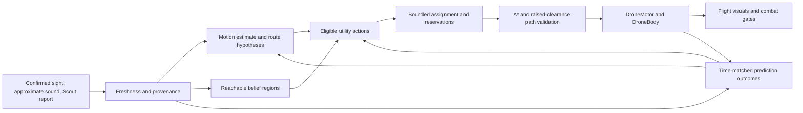

# Interceptor decision and evidence flow

| Stage | Source and evidence |
| --- | --- |
| Deploy and coordinate | `WorldGenerator` → `OutdoorInterceptorDispatch.Deploy`. Generated ownership gives each station an independent brain, navigation graph and response. The dispatch board holds at most 24 source-tagged observations. The optimizer considers at most six tasks per unit and keeps the two-response limit. |
| Estimate and predict | `InterceptorBrain.Decide` passes authorized sightings to `InterceptorPolicy.StepWithMotion`. `InterceptorMotionEstimator` uses observed position changes. `InterceptorPredictionModel.Build` ranks up to six validated alternatives and estimates arrival. |
| Search and select | `InterceptorBeliefState` weights reachable regions and records inspection evidence only when coverage supports it. `InterceptorUtilityDecision` scores eligible actions, with reasons, commitment and switching margin. `OutdoorInterceptorResponse` executes the selected action and motor failures return to route selection. |
| Move | `WaypointGraph.FindRouteWithTrace` exposes A* visits. `ControlTacticalRouteValidator` checks complete NavMesh segments and the raised drone envelope. `DroneMotor` executes the route through the existing NavMeshAgent. `DroneBody` checks physical motion and can correct or hold unsafe movement. |
| Render and apply combat | `DroneRotorVisuals` and `DroneAnimationPose` read accepted movement. `DroneBrain.TryShoot`, weapon effects, shared health and wreck motion retain independent authorization and one-time death. |
| Evaluate and adapt | `InterceptorLearning` and `InterceptorPredictionEvaluator` store original snapshots and match compatible visual observations by timestamp. `InterceptorTacticalMemory` keeps bounded, aged outcomes. Physical obstructions do not alter prediction reliability. |
| Inspect | `OutdoorInterceptorDiagnostics` uses seven pages in the existing F6 overlay. A* visits are requested only on the controller page, and recorder handles are opened only on the performance page. |

The complete prediction and recovery mathematics remain in the [F4 report](../../STUDENT04_INTERCEPTOR_PHASE_F4.md). F5 adds diagnostics, route scratch-buffer reuse, executable evidence and documented regressions.
