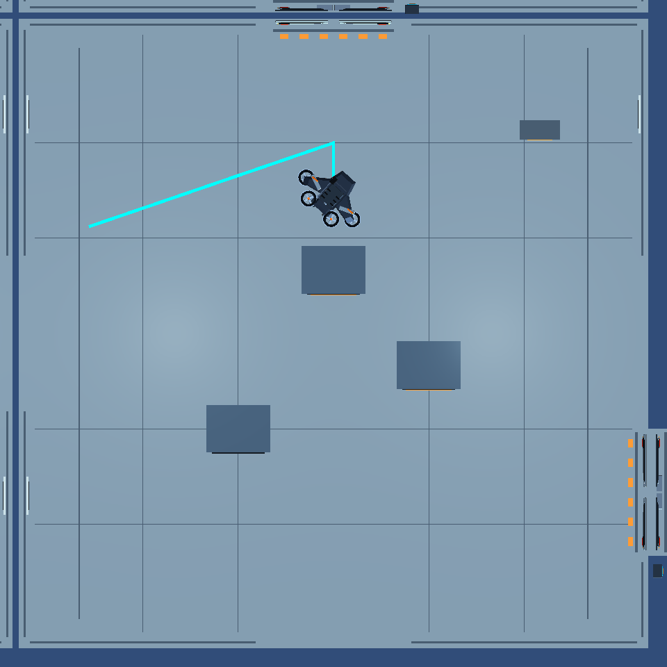
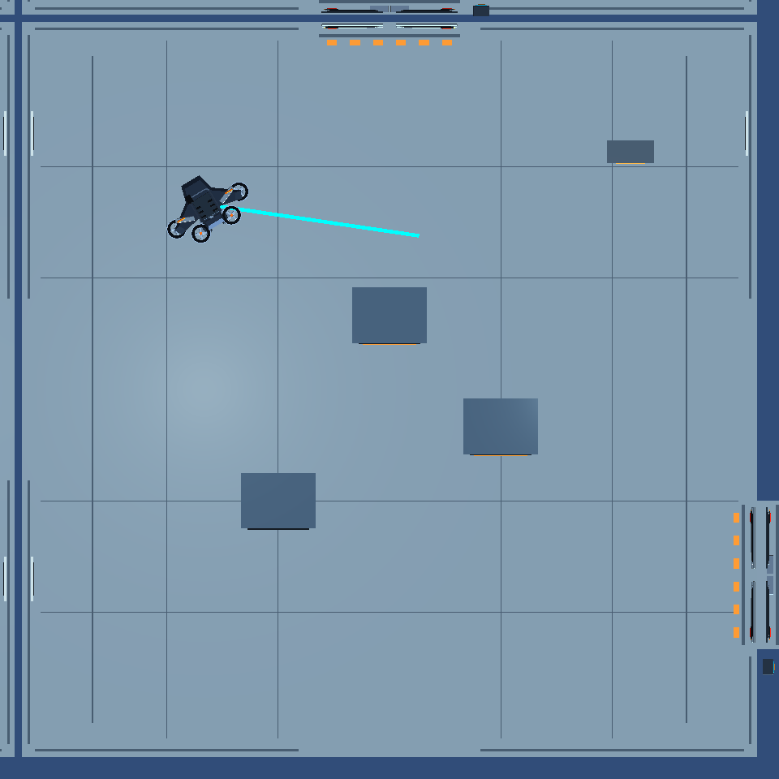
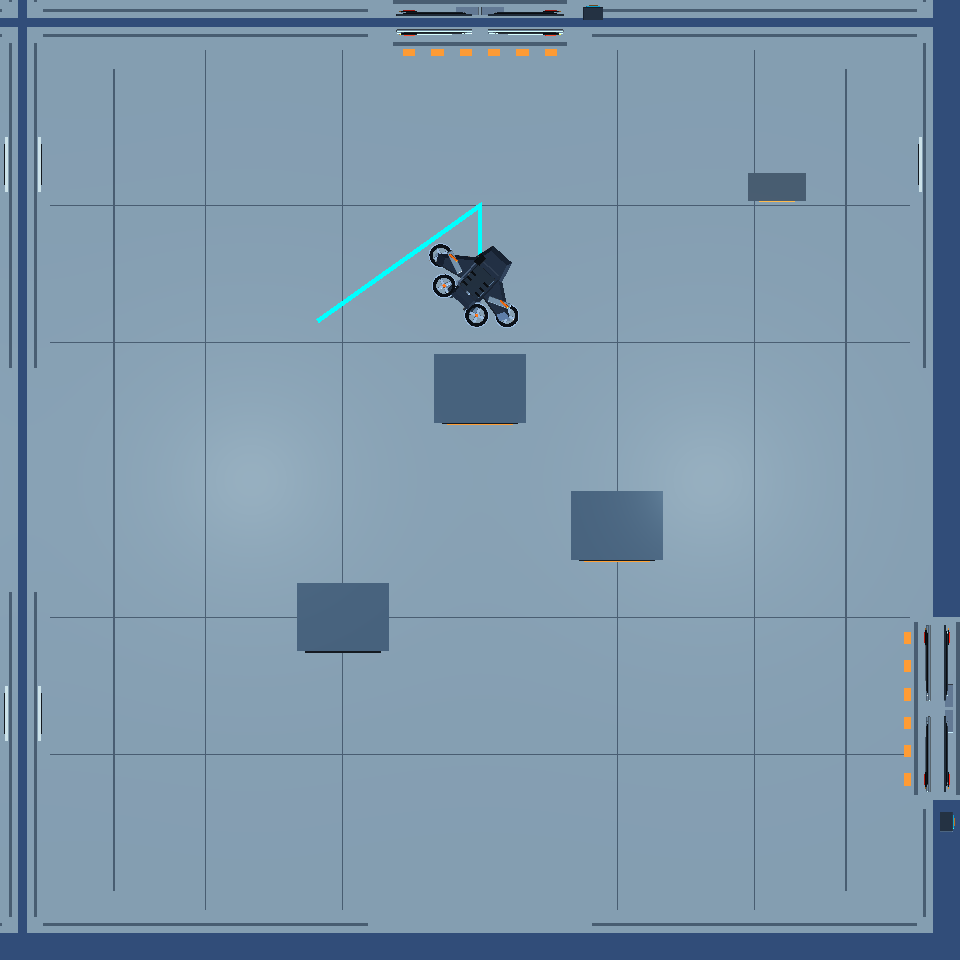
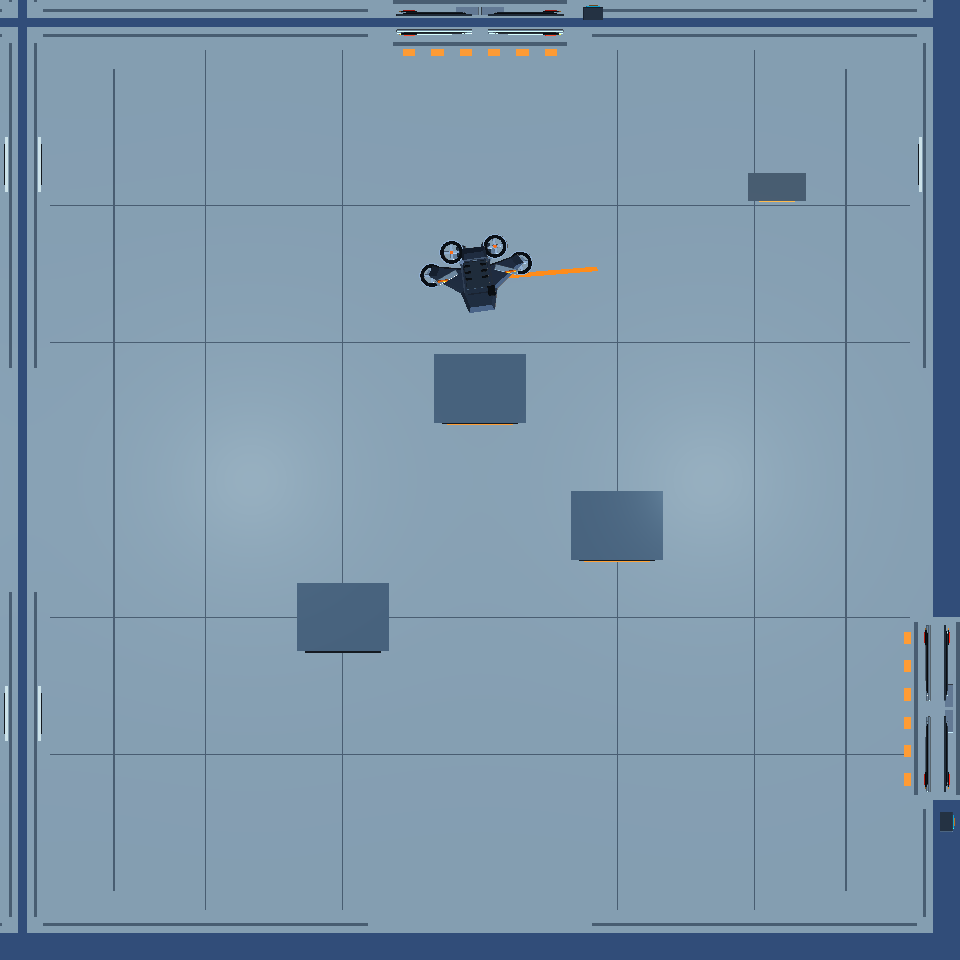
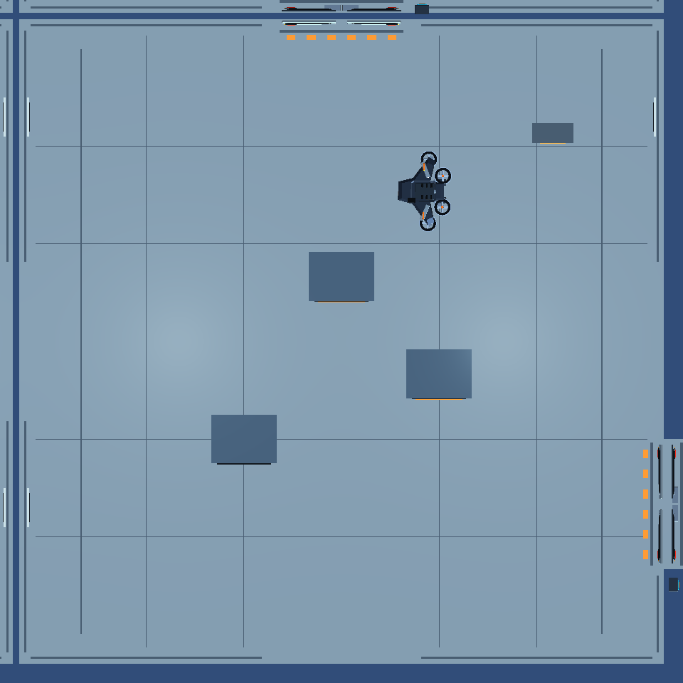
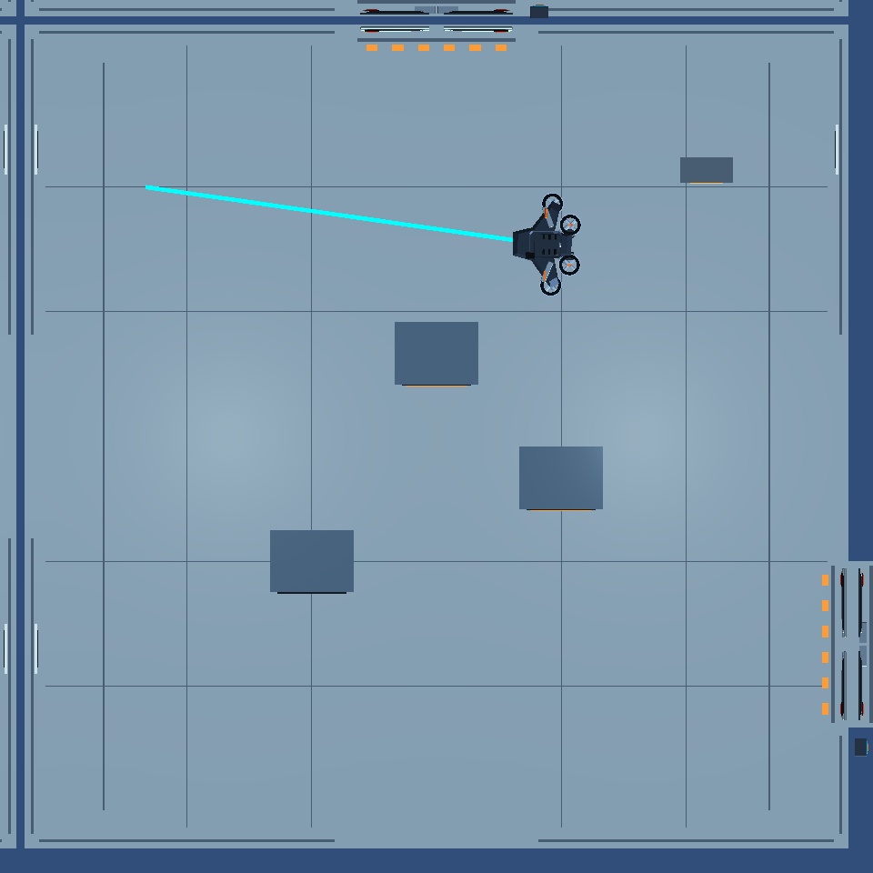

# Task 11 — Actual MainLab tactical scenarios

These are rendered Unity **6000.6.4f1** tests of the pending Flanker review patch in a disposable project. Active MainLab, Storage, NavMesh and other policies are untouched. Temporary cameras, route lines and blockers are destroyed during test teardown. No AI-generated imagery or edited scene is used.

## Reproduce

From the active repository root:

```sh
python3 docs/evidence/tactical-flanker/rehearse.py --demo-only
```

The script copies the project, checks the saved Flanker preimage and installs the proposed source/tests only in that copy. It runs four scenarios and prints XML/log/capture paths. Use `--prepare-only` to open the copy in Unity and run `TacticalFlankerPlayModeTests` through the Play Mode Test Runner, or `--full` for complete project regressions. New imports can take several minutes.

The fixture freezes other agents and player input. It selects a real body-clear Storage placement and genuinely visible player; this is scripted verification, not a full human start-to-exit playthrough. The static camera looks down from below the existing roof. The first-person player has no rendered body in these overhead views; its measured coordinates and the actual LOS assertions establish the target location. Only the selected route is drawn, while test assertions verify both candidates. Temporary blockers are collider-only test objects and are not rendered; the route/occupancy assertions establish their effect. In an interactive paused test, select the temporary blocker in the Hierarchy to inspect its collider bounds. Cyan lines show validated visual-tactical routes, orange lines show sound-only routes. Traces contain the actual world coordinates; camera perspective alone does not establish clearance.

## Both left/right approaches available



[Measured tactical row](Visible-two-flanks.csv). Both candidates must exist with complete A*/native routes, valid raised-body endpoints and at least 2.5 m standoff from the genuine observed target. Scores use the documented owner formula, including path cost, lateral quality, range and remembered firing-line quality. The selected full route is rendered. The GUI diagnostic also exposes each candidate's component scores.

## One route becomes ineffective



[Measured tactical row](One-flank-blocked.csv). A temporary solid occupies the committed endpoint. The setup explicitly verifies the opposite endpoint still has a complete body-clear route; obstructing a shared corridor would instead be a both-unreachable case. The next decision must invalidate the original commitment, record failure and select the opposite side. Ordinary timing/margin commitment does not protect an impossible route.

The pure-policy and separate runtime cooldown cases verify that removing the temporary blocker cannot immediately attract the drone back to the recently failed side. Small score differences do not produce alternating left/right decisions.

## Both side areas unavailable



[Measured tactical row](Both-flanks-blocked.csv). Larger temporary solid obstacles occupy both candidate areas. The Flanker must reject flank selection and choose reachable standoff pursuit or a clear Storage fallback. A successful route and endpoint must still pass normal body checks; unavailable paths do not authorize passage through the obstacles.

## Sound without visual confirmation, then return

| Investigate approximate sound | Bounded sound-area search | Evidence expired; return to post |
| --- | --- | --- |
|  |  |  |

[Actual movement trace](MainLab-demo.csv) and [measured summary](scenario-measurements.json). A production gunshot event three metres from the starting drone passes through the existing sound bus, hearing sensor and awareness state machine. Because hearing estimates include uncertainty, the accepted direction and precise goal can vary between instance IDs. The fixture tries a fixed cardinal sequence until the production sensor has a reachable approximate clue.

In the final full run, the trace records **13 sound actions**, including **7 Search samples**, from 0.733 through 4.800 seconds. At 8.500 seconds the drone is 0.846 m from its selected post, with a 2.8 m/s cap. All 26 samples retain zero visual observations.

The player remains far outside vision. The Flanker must act on sound for at least three samples, travel more than one metre, retain zero visual observations and zero visual velocity, then physically arrive within 1.2 m of its selected reachable Storage post after evidence expires. Returning via an intermediate waypoint alone cannot satisfy the test. The final target speed must be 2.8 m/s; hearing travel uses the existing 3.5 m/s investigation mode.

When the authored home point has no safe approach, the proposal chooses and retains a nearby post within 3.5 m of Home. Motor stopping tolerance means the final root need not equal that exact point. No room object or authored Home is moved. Shared awareness may still call the phase ReturnToPost at physical arrival because its own at-post check uses the unchanged authored Home; policy navigation uses the validated nearby post.

## Additional evidence and limits

The rendered cases do not establish every edge condition. Other new tests cover actual observed reversal, cover-blocked vision/fire, hidden relocation, locked Control/Exit gates, smooth chase acceleration and full body/player clearance, visual-memory expiry, repeated failure cooldown and terminal death. Pure tests include poisoned hidden positions, no-progress and ineffective-arrival failures, score accounting and switching hysteresis.

All captures are rendered from the final proposal and losslessly converted from the retained TGA files. They demonstrate decisions and movement in the current room geometry; they do not certify human Very Hard balance, full-mission capture rate or performance on another machine. The eight private Storage connectors need owner review if furniture/NavMesh changes. Candidate cover scores are positional estimates; only unchanged shared live sight/range/fire checks can authorize damage.

See [test results and retained iterations](README.md) and [approval handoff](../../TACTICAL_FLANKER_HANDOFF.md).
